# Analytics Suite – Nastavení

> Aktualizace: 22.10.2026

Modul **Analytics Suite** rozšiřuje možnosti analýzy dat a vizualizace klíčových ukazatelů v prostředí Dynamics 365 Business Central. Pro správné fungování je nutné provést následující nastavení:

- **Instalace rozšíření v Business Central**
- **Nastavení Analytics Suite v Business Central**
- **Připojení Power BI aplikace k vlastním datům**

## Instalace rozšíření v Business Central

1. Přihlaste se do prostředí Business Central.
2. Otevřete **AppSource** a vyhledejte **Analytics Suite**.
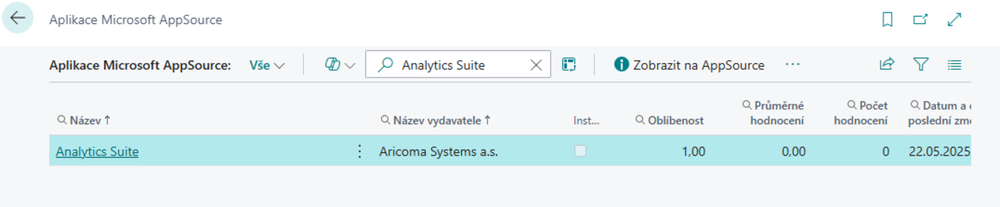
3. Vyberte rozšíření **Analytics Suite for Business Central** a klikněte na **Nainstalovat aplikaci**.
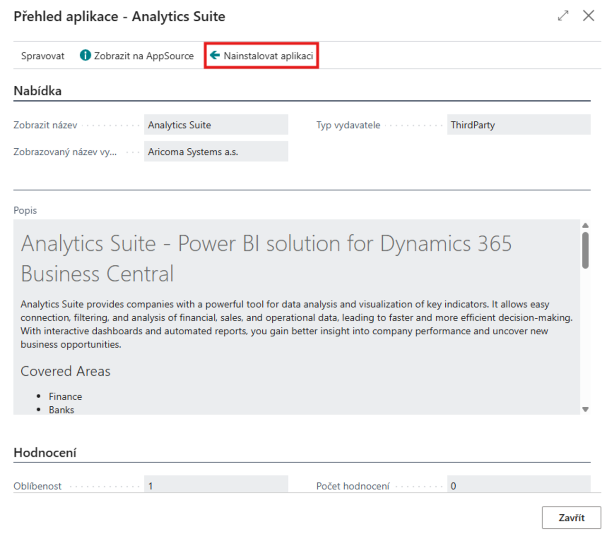
4. Dokončete instalaci dle průvodce.
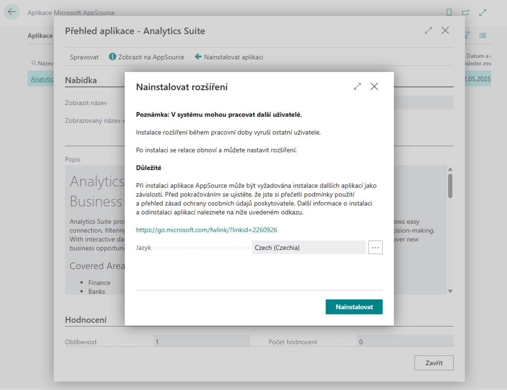

Spolu s rozšířením **Analytics Suite** se automaticky nainstaluje také závislé rozšíření **Monetization** (Aricoma Systems a.s.), které ověřuje platnost předplatného.

> [!NOTE]
> V produkčním prostředí SaaS se při aktivaci modulu a při každém načtení dat ověřuje zakoupené předplatné Analytics Suite. Bez platného předplatného se zobrazí chyba *Nemáte zakoupenou sadu Aricoma Analytics Suite. Požadované funkce nelze použít!* V prostředí Sandbox a v instalaci On-Premises se předplatné neověřuje.

### Aktivace produktu v produkčním prostředí

V produkčním prostředí je po instalaci nutné aktivovat produkt Analytics Suite:

1. Vyberte ikonu , zadejte **Seznam předplatných ARICOMA** a poté vyberte související odkaz.
2. Otevřete stránku **Nákup produktu firmy ARICOMA**.
3. Vyberte řádek s rozšířením **Analytics Suite** (doplněk **Analytics Suite**). Pole **Rozšíření instalováno** musí být zaškrtnuté.
4. Spusťte akci **Koupit produkt** a pokračujte podle průvodce.

    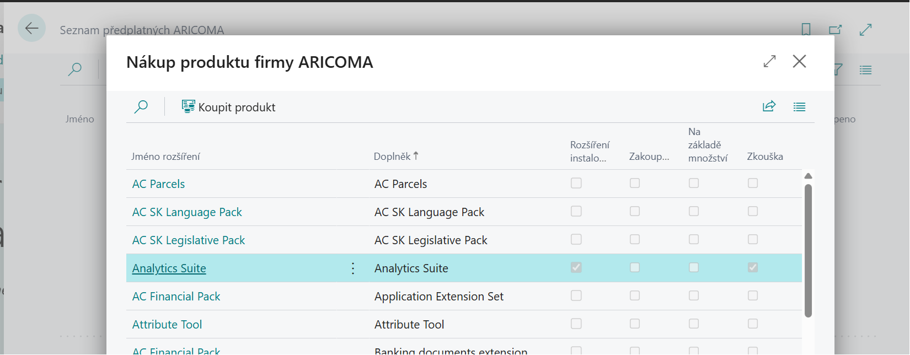

Stav předplatného ukazují pole **Zakoupeno** a **Zkouška**. Po dobu zkušebního období je zaškrtnuté pole **Zkouška**. Po dokončení nákupu je zaškrtnuté pole **Zakoupeno**. Podrobnosti o správě předplatného najdete v článku [Monetizace](monetization.md).

## Nastavení Analytics Suite v Business Central

Nastavení modulu se provádí na těchto stránkách:

|Stránka|Pole|Platnost|Povinné|
|-|-|-|-|
|**Nastavení Analytics Suite**|**Povoleno**, **Datum uzávěrky historických dat**|Společné pro všechny společnosti|Ano|
|**Informace o společnosti**|**Zahrnout do Analytics Suite**|Pro každou společnost zvlášť|Ano|
|**(Finanční výkaz) Definice řádků**|**Zahrnout do Analytics Suite**|Pro každou definici zvlášť|Jen pro reporty finančních výkazů|

### Aktivace modulu

1. Vyberte ikonu , zadejte **Nastavení Analytics Suite** a poté vyberte související odkaz.
2. Na stránce **Nastavení Analytics Suite** na záložce **Obecné** vyplňte pole:

    |Pole|Popis|
    |-|-|
    |**Povoleno**|Aktivuje funkce modulu Analytics Suite. Dokud není modul povolen, nelze v **Informacích o společnosti** zahrnout společnost do Analytics Suite a Power BI aplikace nenačte žádná data.|
    |**Datum uzávěrky historických dat**|Volitelné. Věcné položky, položky zboží a položky ocenění zaúčtované do tohoto data (včetně) se exportují pouze v agregované podobě – seskupené po měsících a podle globálních dimenzí. Položky zaúčtované po tomto datu se exportují s plnými detaily. Pokud pole necháte prázdné, exportují se všechna data detailně. Pole slouží ke zmenšení objemu dat a zrychlení načítání u databází s dlouhou historií.|

    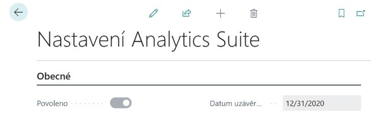

> [!NOTE]
> Nastavení na stránce **Nastavení Analytics Suite** je společné pro všechny společnosti v prostředí – stačí ho provést jednou.

### Zahrnutí společností

1. Vyberte ikonu , zadejte **Informace o společnosti** a poté vyberte související odkaz.
2. Na stránce **Informace o společnosti** ve skupině **Aricoma Analytics Suite** zaškrtněte pole **Zahrnout do Analytics Suite**.
3. Kroky 1–2 opakujte v každé další společnosti, kterou chcete v Analytics Suite analyzovat.

    

> [!IMPORTANT]
> Pole **Zahrnout do Analytics Suite** lze zaškrtnout až po povolení modulu. Jinak se zobrazí chyba *Tuto akci nelze spustit, pokud není povoleno rozšíření Aricoma Analytics Suite!*

### Zahrnutí finančních výkazů

Do Analytics Suite se exportují pouze definice finančních výkazů, které jsou k tomu výslovně označeny.

1. Vyberte ikonu , zadejte **Definice řádků** a poté vyberte související odkaz.
2. Na stránce **(Finanční výkaz) Definice řádků** zaškrtněte u každé definice, kterou chcete v Power BI vyhodnocovat, pole **Zahrnout do Analytics Suite**.
3. Postup opakujte v každé společnosti zahrnuté do Analytics Suite.

    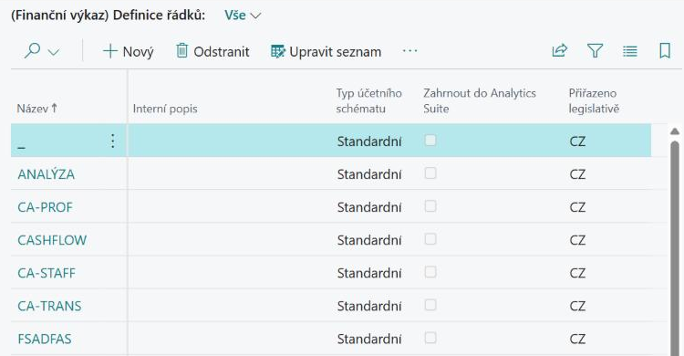

### Sady oprávnění

S instalací modulu je k dispozici následující sada oprávnění:

|Název sady|Popis|
|-|-|
|**ANALYTICSSUITE_ACC**|Přístup k funkcím modulu (stránka nastavení a API stránky Analytics Suite), nikoliv k datům. Uživatel nebo aplikace, pod kterou se Power BI připojuje, potřebuje navíc oprávnění ke čtení dat Business Central.|

## Připojení Power BI aplikace k datům

Pro správné zobrazení reportů a dashboardů je nutné propojit Power BI aplikaci s vaším prostředím Business Central:

1. Přejděte na [powerbi.com](https://powerbi.com) a přihlaste se.
2. V levém panelu zvolte **Aplikace**.
3. Klikněte na **Získat aplikace**.
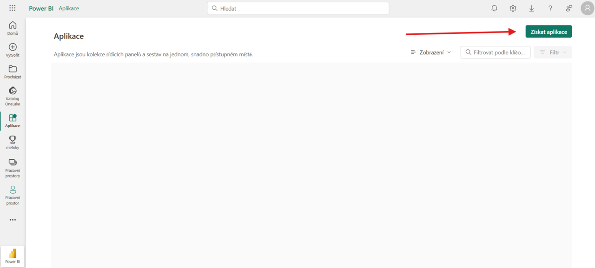
4. Do vyhledávacího pole zadejte **Analytics Suite** a vyberte aplikaci od společnosti **Aricoma**.
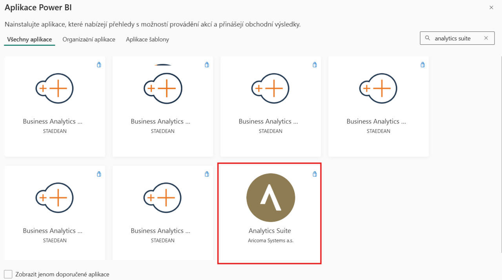
5. Klikněte na **Získat hned** a nainstalujte aplikaci.
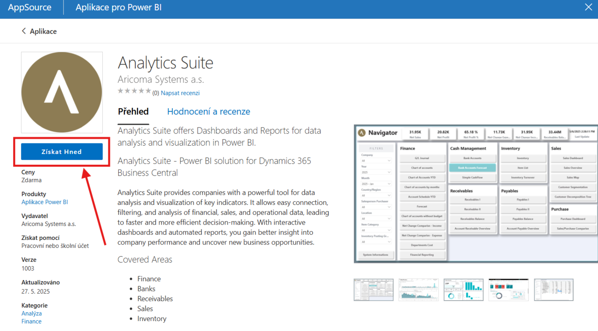
6. Otevřete aplikaci **Analytics Suite** v příslušném workspace.
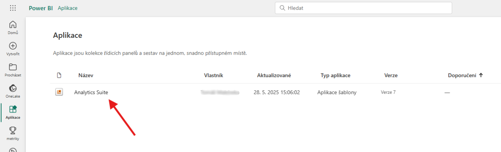
7. Klikněte na **Připojit data**.
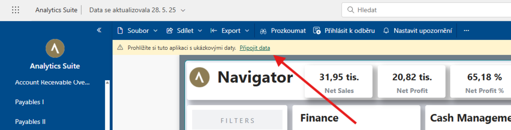
8. Do pole **EnvironmentName** zadejte název prostředí vaší instance Business Central.

## Viz také

[Analytics Suite – Přehled](analytics-suite.md)  
[Streamline Tools](streamlinetools.md)
